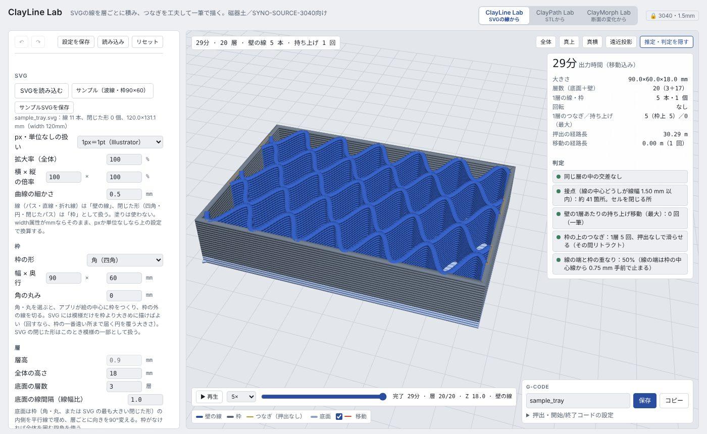

# ClayLine Lab（SVG の線から描く）

**開く：** https://kanejun06.github.io/claypath-lab/svg/　　[説明書の目次](README.md)／[共通の使い方](common.md)

SVG に描いた線を、そのまま層ごとに積み上げて形にするツールです。描いた線がノズルの通り道になるので、トレイ・格子・敷物のような低く平たいものに向いています。線と線のつなぎ方を工夫して、できるだけノズルを持ち上げずに一筆で描きます。

## 基本の手順

1. 「SVGを読み込む」か、プレビューへのドラッグ＆ドロップで SVG を入れる。まず「サンプル（波線・枠90×60）」で試すとよい。「サンプルSVGを保存」で Illustrator のひな形にできる
2. 「枠」で外形を決める（角・丸・SVG の閉じた形・なし）
3. 「層」で全体の高さと底面の層数を決める
4. 「経路」で描く順序と、線と線のつなぎ方を決める
5. 必要なら「層ごとの回転」で模様を 1 層ずつ回す
6. 「推定・判定」で交差・接点・持ち上げ回数を確かめて、G-code を保存する

## SVG の用意

- **開いた線**（パス・直線・折れ線）は「壁の線」、**閉じた形**（四角・円・閉じたパス）は「枠」として扱います。塗りは使いません
- 単位：`width` 属性が mm ならそのまま。px や単位なしは「px・単位なしの扱い」で換算します（Illustrator は 1px＝1pt、Figma・ブラウザは 96dpi）
- 文字はアウトライン化してから。`text`・`use`・画像は読みません
- 「拡大率（全体）」「横 × 縦の倍率」で大きさを、「曲線の細かさ」で曲線を何 mm ごとの点にするかを決めます

## 枠

| 枠の形 | 動き |
|---|---|
| 角（四角）・丸 | アプリが絵の中心に枠をつくり、枠の外にはみ出た線を切る。SVG には模様だけを枠より大きめに描けばよい（層ごとに回すなら、枠の一番遠い所まで届く円を覆う大きさに） |
| SVG の閉じた形を使う | SVG の閉じた形が枠になる |
| なし | 枠を描かない |

## 層

- 層高は機械の設定（0.9 mm、ロック）
- 「全体の高さ」と「底面の層数」を決めます。底面は枠の内側を平行線で埋め、層ごとに向きを 90° 変えます（枠がなければ全体を囲む四角）

## 経路

| 設定 | 内容 |
|---|---|
| 描く順序 | 近い順（自動）：前の層の終点から近い線へ。層ごとに向きが自然に入れ替わる／SVG に書いた順 |
| 枠を描くタイミング | 先に（線の受けになる）／後に／描かない |
| 線と線のつなぎ | **枠に沿って押出**（既定）：線の端と次の線の端が両方とも枠の近くにあるとき、枠の上をなぞって次の線へ。既定は押出 0 で、ノズルを下げたまま枠の上を滑らせるだけ／**直線で押出**：中に新しい壁ができるので短いときだけ／**移動**：持ち上げて移動 |
| 最大長・距離 | 枠に沿うつなぎ・直線つなぎの最大長、「枠に乗る」とみなす距離。条件に合わなければ次の方法に切り替わる |
| 線の端と枠の重なり | 線の端の粘土が枠にかぶる幅（線幅比）。100% で枠の中心線まで（はみ出しやすい）、0% で枠の内側の縁で止まる。既定 50% |

## 層ごとの回転

- 「1層あたりの回転」と「回り方」（一方向に回し続ける／往復する／交互）で、模様を層ごとに回します
- 「交互」は 0° と回転角を層ごとに入れ替える（2 枚の絵を交互に積むのと同じ。上の層の線は交点だけで支えられる）
- 「回すもの」：線だけ（枠は固定、はみ出しは枠で切る）／枠も一緒に。回転の中心は絵の中心で、底面は回しません

## 太さ・速度

- 「壁の線の太さ」「枠の太さ」：押出量（E）の倍率。速度は変えずに太さだけ変わります
- 「SVGの線の太さを押出に反映」：`stroke-width ÷ 線幅` を線ごとの倍率にして掛けます（「太さ倍率の範囲」で切り詰め）。線の太さで壁の厚みを描き分けられます
- 「移動後の先押し」：持ち上げ移動のあと、書き始める前に足す押出（出始めのかすれ対策）
- 速度・初層速度は機械の設定（ロック）

## 判定で見るところ

| 判定 | 意味 |
|---|---|
| 同じ層の中の交差 | 線どうしが交わる所。粘土が重なって盛り上がる |
| 接点 | 線の中心どうしが線幅以内に近づく所。セル（格子の目）を閉じる所でもある |
| 1 層あたりの持ち上げ移動 | 0 回なら一筆。多いと糸引き・かすれが増える |
| 枠の上のつなぎ | 枠の上を滑らせて次の線へ行く回数 |
| 線の端と枠の重なり | 線の端が枠の中心線からどれだけ手前で止まるか |

プレビュー下の凡例で、壁の線・枠・つなぎ（押出なし）・底面・移動を色で見分けられます。「移動」のチェックで移動経路の表示を切り替えます。

## うまくいかないとき

- **持ち上げが多い**：「枠に沿うつなぎの最大長」を長くする、線の端を枠の近くまで描く、描く順序を「近い順」にする
- **線の端が枠からはみ出す・盛り上がる**：「線の端と枠の重なり」を小さくする
- **格子の目が閉じない**：接点の数を確認する。線どうしを少し深めに交わらせて描く
- **回すと線が枠の外に出る**：「回すもの」を「線だけ」にする（はみ出しは枠で切られる）
