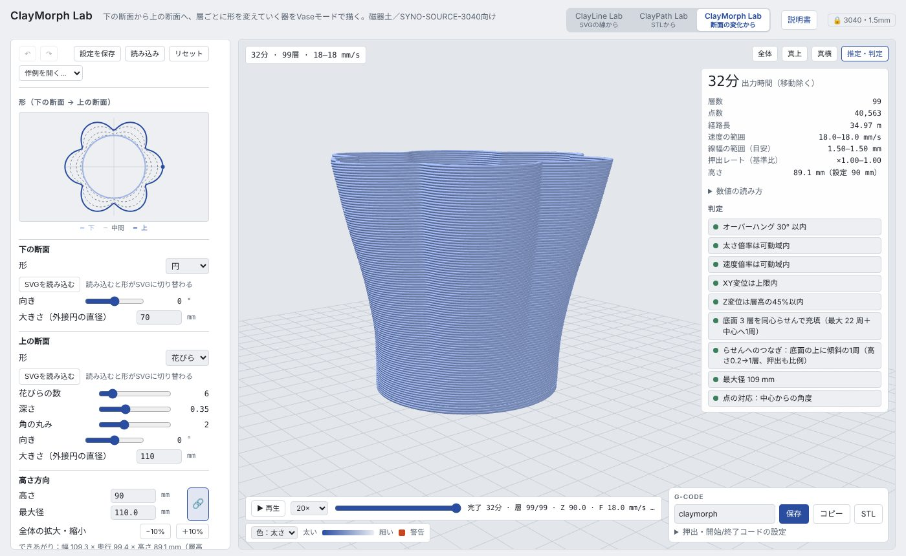
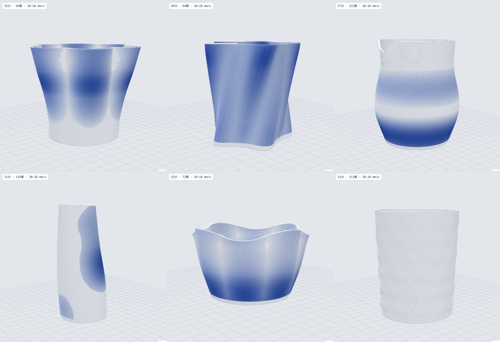
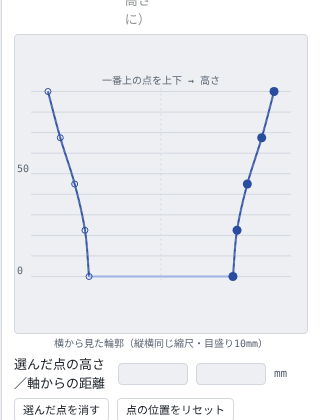

# ClayMorph Lab（断面の変化から描く）

**開く：** https://kanejun06.github.io/claypath-lab/morph/　　[説明書の目次](README.md)／[共通の使い方](common.md)

下の断面から上の断面へ、層ごとに形を少しずつ変えていく器を、Vase モードの一筆で描くツールです。STL や CAD は要りません。「底は丸、口は星形」「断面が花びら形で上に行くほど開く」のような形を、断面・横から見た輪郭・形の変わり方の組み合わせで作ります。

## 基本の手順

0. まず「作例を開く…」から選ぶと、断面・輪郭・口の形などの組み合わせ方がつかめる
1. 「下の断面」「上の断面」で形を選ぶ（円・花びら・星・多角形・楕円、または SVG）
2. 「高さ方向」で高さと最大径を決める
3. 「横から見た輪郭」で、正面から見た壁の線を点のドラッグで整える
4. 「形の変化」のカーブで、下の形から上の形へどの高さで変わるかを決める。必要なら「ねじれ」を足す
5. 「推定・判定」でオーバーハング（赤）を確かめて、G-code を保存する

## 作例

「作例を開く…」の 6 つ（左上から）：花びらの花器、ねじれた星のカップ、注ぎ口のピッチャー、傾いた一輪挿し、波打つ口のボウル、ドット模様のタンブラー。開いたあと自由に変えられ、⌘Z で元に戻せます。

## 断面（下・上）

| 形 | 調整できること |
|---|---|
| 円 | — |
| 花びら | 花びらの数、深さ（へこみの深さ）、角の丸み（へこみのなめらかさ） |
| 星 | 先の数、内側の比率、角の丸み |
| 多角形 | 角の数、角の丸み |
| 楕円 | 縦横比 |
| SVG | 「SVGを読み込む」で、SVG の閉じた形のうち一番大きいものを使う |

- どの形も「向き」で回せます。上下で花びらの向きをずらすと、ねじれた変化になります
- 「大きさ（外接円の直径）」で大きさを決めます。SVG の大きさ・位置は関係なく、ここの値と輪郭の中心で揃えます
- 「SVGを読み込む」はいつでも押せます。読み込むと形が自動で SVG に切り替わり、テンプレートに戻しても SVG は残ります
- 「形」の一番上のプレビューで、下（薄い線）・中間（点線）・上（濃い線）の断面の重なりを確かめられます

### 点の対応のとり方

2 つの断面を混ぜるとき、どの点とどの点を対応させるかです。ふつうは「自動」のままで構いません。

- **中心からの角度**：中心から見た各方向の距離を混ぜる。円 → 星・花びらのような放射状の形がきれいに変わる
- **周の長さ**：輪郭を同じ長さの割合で対応させる。C 字・L 字のように、中心から見て輪郭が重なる形はこちら（自動ではそう切り替わる）

## 高さ方向

### 高さ・最大径と 🔗

- 🔗 が押されている間は、高さか最大径のどちらかを変えると、もう一方と輪郭全体が同じ比率で変わります（プロポーションを保つ）
- 🔗 を外すと、高さだけ・最大径だけを変えて、縦に伸ばしたり横に広げたりできます
- 「−10%」「＋10%」は、いつも全体を同じ比率で拡大・縮小します
- 造形範囲（最大径 280 mm・高さ 380 mm）を超えないように止まります。拡大しても層高と線幅は変わりません

### 横から見た輪郭

正面から見た器のシルエットを、縦横同じ縮尺（目盛り 10 mm）で編集します。

| 操作 | 方法 |
|---|---|
| 点を動かす | ドラッグ（上下・左右とも）。選んだ点は矢印キーで 1 mm、Shift で 5 mm |
| 高さを変える | 一番上の点を上下にドラッグ |
| 点を足す／消す | 空いている所をダブルクリック／点をダブルクリック（または「選んだ点を消す」） |
| 数値で指定 | 「選んだ点の高さ／軸からの距離」 |
| 戻す | 「点の位置をリセット」（最初の 5 点のなめらかな広がり）、「まっすぐに戻す」（下と上を直線で結ぶ） |

- **左右対称**（初期 ON）：右の壁が左にも写ります。OFF にすると左右の壁を別々に動かせ、傾いた器や片側だけふくらむ器になります（断面の中心の動きは点線で表示）
- **上下対称（左右の点を同じ高さに）**（初期 ON）：左右の点がいつも同じ高さにそろい、片側を上下に動かすともう片側も動きます。OFF にすると左右の点を別々の高さに置けます
- 一番下と一番上の点は、下の断面・上の断面の「大きさ」と連動します
- **赤い線**は壁の傾きがオーバーハング警告の角度（初期 30°）を超えている所です。輪郭は外接円の直径で決めるので、花びらや星のへこんだ部分はこの線より内側を通ります

### 形の変化とねじれ

- 「形の変化」のカーブ：0＝下の形、1＝上の形。下のほうは丸いまま、上で一気に星になる、などを決めます。ダブルクリックで直線に戻ります
- 「ねじれ（全体）」：底から口までに断面を回す角度

## 層と底面・変調

- 「傾斜補正（斜めの壁ほど太く）」を ON にすると、広がる所・傾けた所ほど線を太くして、壁の厚みを線幅にそろえます（詳しくは [ClayPath Lab の説明](claypath.md#モデル)）。大きく広げる器では ON を勧めます
- 底面の充填は、同心らせんで埋めきれない形（くびれ・凹み）では自動で「外周＋往復」になります。「底面の充填のしかた」で固定もできます
- らせんへのつなぎ、太さ・速度・XY の変調は [ClayPath Lab](claypath.md#3-つの変調) と同じです
- 口の縁を斜め・波・注ぎ口にする「口の形」も使えます（[ClayPath Lab の説明](claypath.md#口の形斜め波注ぎ口)）。STL 書き出しには入りません
- 白黒の画像で壁に凹凸をつける「画像のバンプ」も使えます（[ClayPath Lab の説明](claypath.md#画像のバンプ白黒の画像で凹凸)）。STL 書き出しには入りません

## 途中で休止（乾かす時間をとる）

「途中で休止する層」に層の番号を入れると、その層の刷り始めでノズルをその場に止めたまま、「休止の長さ」（既定 60 秒）だけ待ってから続きを刷ります（G-code の `G4`。リトラクトも持ち上げもしないので、再開時に引けない）。層の番号は再生バーの「層 ○/○」と同じ数え方なので、再生で崩れそうな層を探してそのまま入れられます。その間に扇風機やドライヤーで乾かせます。複数の層はカンマで区切ります（例：`45, 60`）。上の方が柔らかくて崩れる形は、外へ開き始める層の手前で休止を入れると効きます。休止の時間は所要時間と再生にも入ります。

## 設定の保存

「設定を保存」で、断面・輪郭（左右の点）・カーブ・トグル・画像のバンプ（画像込み）・口の形・読み込んだ SVG の輪郭を 1 つの .json に保存します。「読み込み」で開けば同じ G-code が出る状態に戻ります。「リセット」は読み込んだ SVG を残したまま設定を最初の値に戻します。

## 形を STL で保存

G-code 欄の「STL」で、器の形を 1 つの閉じた立体の STL として保存できます（Cura の Vase モードでスライスできる。変調は入らない）。詳しくは[共通の使い方](common.md#形を-stl-で保存)。

## うまくいかないとき

- **輪郭に赤い所がある**：その高さの点を内側へ、または上下に離して傾きをゆるくする。🔗 を外して高さだけ伸ばすのも有効
- **ねじれで先端が崩れる**：星・花びらの先は横にずれるので、ねじれを弱めるか、先を丸くする（角の丸み）
- **形が途中で乱れる**：点の対応を「周の長さ」にする（中心から見て輪郭が重なる形のとき）
- **底に穴があく**：底面の層数を 3 以上にする
