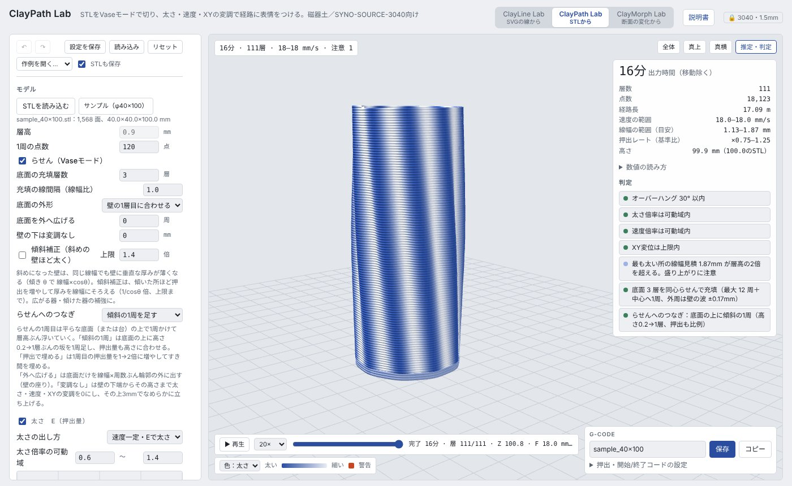

# ClayPath Lab（STL から描く）

**開く：** https://kanejun06.github.io/claypath-lab/　　[説明書の目次](README.md)／[共通の使い方](common.md)

STL（回転体に近い形）を Vase モード（らせん状の一筆）で切り、**太さ（E）・速度（F）・XY のうねり・Z の波打ち**で経路に表情をつけるツールです。形は Fusion などの CAD で決め、表面の質感を経路で作ります。

## 基本の手順

1. 「STLを読み込む」かドラッグ＆ドロップで STL を入れる（まず「サンプル（φ40×100）」で試すとよい）
2. 「モデル」で 1 周の点数・底面の層数・らせんへのつなぎを決める
3. 太さ・速度・XY・Z の 4 つの変調で表情をつける。各系統は見出しのチェックで ON/OFF
4. 「推定・判定」で出力時間・線幅・押出レート・オーバーハングを確認し、「▶ 再生」でノズルの動きを見る
5. 「保存」で G-code を書き出す

## STL の用意

- **回転体に近い、1 枚の壁でできる形**が前提です。各高さで輪郭を 1 つだけ取り（複数あれば一番大きいもの）、らせんでつなぎます
- 中を詰めた形、厚い壁、取っ手のように輪郭が分かれる形は向きません（その場合は Cura などの通常のスライサーへ）
- 底は STL の底面に置かれます（Z の最小が 0 になるように自動でずらす）

## モデル

| 設定 | 内容 |
|---|---|
| 層高 | 機械の設定（0.9 mm、ロック） |
| 1周の点数 | 輪郭を何点で回るか。変調の波数が多いときは増やす |
| らせん（Vaseモード） | ON で継ぎ目のない一筆。OFF で層ごとに閉じた輪 |
| 底面の充填層数／線間隔 | 底を何層埋めるか（3 以上推奨）。同心らせんで埋まらない形（くびれ・凹み）は自動で「外周＋往復」になる |
| 底面の外形／外へ広げる | 底面の外周を壁の 1 層目（変調込み）に合わせるか、STL の輪郭のままか。「外へ広げる」で底面だけ線幅 × 周数ぶん外に出す（座り） |
| 壁の下は変調なし | 壁の下端からこの高さまで変調を 0 にし、その上 3 mm でなめらかに立ち上げる |
| 傾斜補正（斜めの壁ほど太く） | 斜めの壁は、同じ線幅でも壁に垂直な厚みが薄くなる（傾き θ で線幅 × cosθ）。ON にすると、傾いた所ほど押出を増やして厚みを線幅にそろえる（1/cosθ 倍、「上限」まで。初期値 1.4 倍）。傾きは変調をかける前の形で測る。広がる器・傾けた器の補強に。初期値は OFF |
| らせんへのつなぎ | らせんの 1 周目は底面から 1 周かけて層高ぶん浮いていくので、その隙間の埋め方を選ぶ。「傾斜の1周を足す」（既定）／「1周目を押出で埋める」／なし |

## 4 つの変調

どれも「高さ方向のカーブ」×「周方向の波（波数・ねじれ・波形）」で決まります。カーブは 5 つの点を上下にドラッグし、ダブルクリックで戻します。

| 変調 | 何が変わるか | 主な設定 |
|---|---|---|
| **太さ E** | 押出量（線の太さ） | 太さの出し方（速度一定で E を変える／流量一定で F を変える）、可動域、周方向の揺れ・波数・ねじれ |
| **速度 F** | ノズルの速さ | 基準速度と初層速度（機械の設定）、速度倍率の可動域、周方向の揺れ |
| **XY** | 輪郭のうねり（外側・内側への出入り） | 振幅・波数・ねじれ・波形（正弦・三角・なめらか矩形・ノイズ）、高さ方向の強さ、上限（ガード） |
| **Z** | 層の波打ち（上下の揺れ） | 振幅・波数・ねじれ・波形、高さ方向の強さ。層高の 45% までに切り詰める |

- 「ねじれ」は 1 mm 上がるごとに波を何度回すか。波が斜めに流れる模様になります
- 太さと速度は押出レート（スクリューの回る速さ）に効きます。判定の「押出レート（基準比）」が大きく振れるときは、スクリューの追従と圧に注意
- 「ガード」の「ノイズの種」を変えると、ノイズ波形の模様が変わります。「変調をすべて戻す」で 4 つを初期値に戻します

## 画像のバンプ（白黒の画像で凹凸）

白黒の画像を器の周りに巻き付けて、明るさに応じて壁を外へ押し出し（または内へ彫り込み）ます。Clay Slicer の画像テクスチャに近い機能です。

1. 「画像を読み込む」で PNG・JPG を選ぶ（まず「サンプル（ドット）」「サンプル（斜めの波）」で試すとよい）。読み込むと自動で ON になる
2. 「深さ」で最大の出っ張り（mm）、「向き」で白を外へ浮き出すか内へ彫り込むか（灰色基準で白は外・黒は内、も選べる）を決める
3. 「周方向の繰り返し」「高さ方向の繰り返し」で画像を何回並べるか、「回転」で貼る位置、「貼る範囲」で壁のどこからどこまでに貼るかを決める
4. 「ぼかし」で輪郭をなだらかにする（急な段差は層に乗らずオーバーハングになりやすい）。「白黒を反転」もできる

- 画像の左右が器の一周（左端＝0°、右回り）、上が口の側です。プレビューの画像がそのまま巻き付くイメージです
- 細かさは経路で決まります。周方向は「1周の点数」、高さ方向は層高 0.9 mm ごと。細かい模様は「1周の点数」を増やすか、ぼかして大きな形にしてください
- 線画のようなくっきりした画像は段差が急になります。ぼかしを 2〜4 px にすると印刷しやすくなります
- 「壁の下は変調なし」はバンプにもかかります。XY のうねりとも重ねられます（バンプは XY の上限（ガード）の外で足す）
- 設定ファイルには画像も入ります（縮小した画像）

## 口の形（斜め・波・注ぎ口）

口の近くで層の厚みを周方向に少しずつ変えて、口の縁を傾けます（層が平らでなくなる経路）。「そそぐ」器の注ぎ口や、持つ側だけ高い縁などに使えます。

| 形 | 動き |
|---|---|
| 斜め（片側を高く） | 「向き」の方向が一番高く、反対側が一番低い。元の高さから ± 「高さの変化」 |
| 波打つ | 「波の数」だけ縁が上下する。± 「高さの変化」 |
| 注ぎ口 | 「向き」の方向の一か所だけ、「注ぎ口の幅」の範囲で高さを変える（マイナスで低く＝注ぎ口）。「外へ張り出す」で注ぎ口を外へ広げられる |

- 上の小さなグラフは、口の高さを一周ぶん展開したもの（点線が元の高さ）
- 「変化させる高さ」は、口からどれだけ下から変化を始めるか。0（自動）なら、層の厚みの変化が ±40% 以内になる長さを取ります。短くすると変化が急になり、判定に注意が出ます
- 押出は層の厚みに合わせて増減するので、線の太さは保たれます
- 注ぎ口を外へ張り出すと、その部分にオーバーハング警告が出やすくなります。張り出しは数 mm から試してください

## 判定で見るところ

- **オーバーハング**：XY の振幅が大きい、ねじれが強いと出やすい
- **線幅の範囲（目安）**：太さ倍率 × 線幅。層高の 2 倍を超えると盛り上がりに注意
- **底面の充填**：同心らせんか外周＋往復か
- **輪郭が複数・取れない層**：STL の形を見直す

## 設定の保存

「設定を保存」で、変調・カーブ・読み込んだ STL を 1 つの .json に保存します（STL を入れたくなければ「STLも保存」を外す）。「読み込み」で開けば同じ G-code が出る状態に戻ります。詳しくは[共通の使い方](common.md#設定の保存読み込み取り消し)。

## うまくいかないとき

- **壁が外に倒れる・赤が多い**：XY の振幅を小さくする、ねじれを弱める、「壁の下は変調なし」で根元を安定させる
- **底と壁のつなぎ目に隙間**：「らせんへのつなぎ」を「傾斜の1周を足す」にする
- **表面がかすれる・途切れる**：太さの可動域の下限を上げる、速度を上げすぎない
- **形が変になる**：STL が回転体に近い 1 枚の壁の形か、輪郭が 1 つかを確かめる
