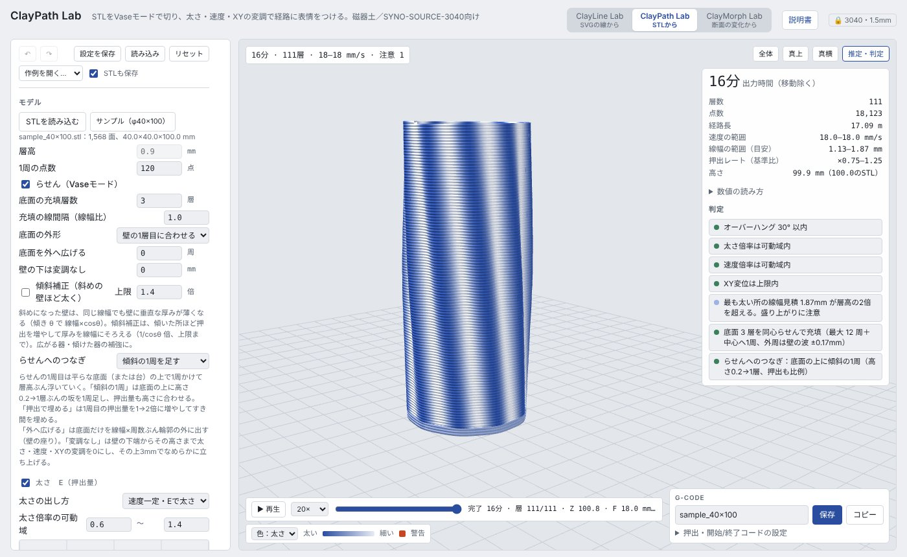
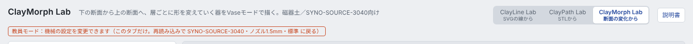
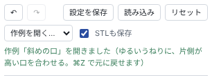

# 共通の使い方

3 つのツール（ClayLine Lab／ClayPath Lab／ClayMorph Lab）に共通することをまとめます。

- [画面のつくり](#画面のつくり)
- [機械の設定と教員モード](#機械の設定と教員モード)
- [印刷までの流れ](#印刷までの流れ)
- [形を STL で保存](#形を-stl-で保存)
- [推定・判定の読み方](#推定判定の読み方)
- [設定の保存・読み込み・取り消し](#設定の保存読み込み取り消し)
- [1 枚で動く版](#1-枚で動く版)
- [Ender-3 V3（PLA）で使う【試験中】](#ender-3-v3pla-で使う試験中)
- [自分の機械に合わせる](#自分の機械に合わせる)
- [困ったとき](#困ったとき)

## 画面のつくり

| 場所 | 内容 |
|---|---|
| 上 | ツールの切り替えタブ（Line → Path → Morph）、「説明書」ボタン（今のツールの説明書が開く）、機械の表示（🔒 3040・1.5mm） |
| 左のパネル | 形と経路の設定。一番上に ↶ ↷（取り消し・やり直し）、設定を保存・読み込み・リセット、「作例を開く…」 |
| 中央 | 3D プレビュー。ドラッグで回転、右ドラッグ（または Shift＋ドラッグ）で移動、ホイールで拡大縮小。「全体」「真上」「真横」で視点を戻す |
| 右上「推定・判定」 | 出力時間・経路長などの見積もりと、印刷前に確かめる判定（緑・青・赤） |
| 下「再生」 | ノズルの動きを時間どおりに再生。バーを動かすと途中の層まで表示できる（底面の確認に便利） |
| 右下「G-code」 | ファイル名を決めて「保存」（または「コピー」） |

プレビューの色は、太さ（押出量）や速度を表します。左下の凡例で切り替えられます。赤はオーバーハング（前の層からはみ出す所）です。

## 機械の設定と教員モード

機械に関わる値は 3 つのツールで共有しています（`shared/printer.js`）。学生の画面ではロックされていて、入力欄がグレーになり、上に「🔒 3040・1.5mm」と出ます。

| 項目 | 値 |
|---|---|
| ノズル／線幅／層高 | 1.5 mm／1.5 mm／0.9 mm |
| フィラメント径（E の換算用）／押出倍率 | 2.2 mm／0.85 |
| 外周速度／初層速度／移動速度 | 18 mm/s／18 mm/s／60 mm/s |
| Z の移動速度／移動時の持ち上げ | 40 mm/s／1 mm |
| リトラクト | 1 mm（30 mm/s） |
| スカート | 1 周・オフセット 6 mm |
| ベッド中心 | X150 / Y150（開始コードの `G92 X-15 Y-30` とあわせて、この組み合わせで印刷位置を確認済み） |
| 造形範囲 | 300 × 300 × 400 mm |

速度を上げた試し刷りなどで値を変えたいときは、**URL の末尾に `?teacher` を付けて開きます**（例：`https://kanejun06.github.io/claypath-lab/morph/?teacher`）。そのタブだけ機械の設定が変更でき、上に赤い表示が出ます。タブで別のツールに移っても教員モードのままです。再読み込みすると元の値に戻ります。

- ロックは誤操作を防ぐためのもので、アクセス制限ではありません
- 設定ファイルを読み込んでも、学生の画面では機械の値はファイルの中身ではなく上の値になります
- 学生が使う値そのものを変えるときは、`shared/printer.js` を書き換えます（[自分の機械に合わせる](#自分の機械に合わせる)）

### E（押出量）の考え方

SYNO-SOURCE-3040 は空圧タンクに加えてエクストルーダーのスクリューがあり、G-code の E がスクリューの送りとして効きます。3 つのツールは E を「線幅 × 層高 × 倍率 ÷ フィラメント断面（径 2.2 mm）」で点ごとに書き出します（Cura の出力と同じ考え方）。太さの変調は、この倍率を点ごとに変えています。

## 印刷までの流れ

1. ツールで形と経路を決める
2. 「推定・判定」で赤（警告）がないか、出力時間が想定どおりかを確かめる。「再生」で底面から壁へのつながりも見ておく
3. 「保存」で `.gcode` を書き出す（保存名が `_gcode.txt` になった場合は、拡張子を `.gcode` に直す）
4. SD カードに入れて機械で開く
5. 針の高さを手で合わせてから印刷を始める。開始コードは **Z を原点復帰しません**（`G28 X0 Y0` のみ。今の針の高さを Z0 とみなす）。XY を原点に戻し、`G92 X-15 Y-30` でベッド中心に合わせ、プラットフォームを 15 mm 下げ、3 mm 押し出してから印刷に入ります

G-code の外で決まる条件も記録しておくと、うまくいった印刷を再現しやすくなります。神戸芸工大で試した時点の例です。**推奨値ではなく検証中の参考値**なので、土や環境に合わせて調整してください：

| 条件 | 例 |
|---|---|
| 空気圧 | 0.3 MPa 前後。土の状態で変わるので、印刷の具合を見ながら調節する |
| 土の配合（土：水） | 出石柿谷陶石 100：43／天草陶石粉末 100：30／「フロスト」100：35（100：33 では硬かった） |
| ベッド | 9 mm MDF |
| 乾燥 | 乾燥で反り・割れが出ることがある。急がずゆっくり乾かす |

## 形を STL で保存

ClayMorph Lab では、G-code 欄の「STL」で、器の形を **1 つの閉じた立体**の STL（`名前.stl`）として保存できます。

- 単位は mm。形の中心が原点、ベッドが Z=0 の位置です
- 層ごとの断面（ノズルが通る壁の中心線）を線幅の半分だけ外へ広げて積み重ね、底と口をふさいだ立体です。Cura の Vase モード（滑らかな外側輪郭）でスライスすると、外壁がほぼ同じ経路を通ります
- 太さ・速度・XY・Z の変調は入りません（デザインした形そのもの）
- 穴のない立体なので、Cura でのスライス、Fusion などでの参考形状・シェル化、レンダリングに使えます。大きさは数 MB 程度です

## 推定・判定の読み方

| 色 | 意味 |
|---|---|
| 緑 | 問題なし |
| 青 | 注意（印刷はできるが、結果を見て調整したい所） |
| 赤 | 警告（崩れる・乗らない可能性が高い） |

よく出る判定：

- **オーバーハング**：前の層から、決めた角度（初期値 30°）以上外に出る点の数。プレビューでは赤く表示されます。広げすぎ・ねじりすぎ・傾けすぎで出ます
- **太さ・速度の可動域**：変調が決めた範囲を超えて、切り詰めた点の数
- **線幅が層高の 2 倍を超える**：太くしすぎて盛り上がる可能性
- **底面の充填**：同心らせんか「外周＋往復」か、持ち上げ移動の回数
- **らせんへのつなぎ**：底面から壁のらせんへの移り方

## 設定の保存・読み込み・取り消し

3 つとも左パネルの一番上にボタンがあります。

| 操作 | ボタン | キー |
|---|---|---|
| 元に戻す | ↶ | ⌘Z／Ctrl+Z |
| やり直す | ↷ | ⇧⌘Z／Ctrl+Y |
| 設定を保存（.json） | 設定を保存 | ⌘S／Ctrl+S |
| 保存した設定を開く | 読み込み | — |
| 最初の値に戻す | リセット（2 回押す） | — |
| 作例を開く | 作例を開く…（メニュー） | — |

- 設定ファイルには、読み込んだ素材も入ります（ClayLine：SVG、ClayPath：STL（「STLも保存」で選択）、ClayMorph：SVG の輪郭）。ファイル 1 つを開けば、同じ G-code が出る状態に戻ります
- 「うまくいった設定」を残す、学生どうしで共有する、授業の記録にする、といった使い方ができます
- **作例**：「作例を開く…」のメニューから、各ツールの作例（ClayLine 4 つ、ClayPath 5 つ、ClayMorph 6 つ）を 1 回で開けます。今の設定は ⌘Z で戻せます。作例は形と経路の出発点で、実機で検証したレシピではありません。判定を見て、小さく試し刷りしてから使ってください。作例は `shared/templates.js` に書かれていて、項目を真似て書き足せます
- **タブで別のツールに移ると、ページを読み込み直すので今の作業は消えます。** 先に設定か G-code を保存してください

## 1 枚で動く版

ふだんは URL を開いて使えば十分です。HTML を手元に保存して使いたいとき（学生に配って改造してもらう、など）は、1 枚で動く版を使ってください。

- https://kanejun06.github.io/claypath-lab/standalone/clayline-lab.html
- https://kanejun06.github.io/claypath-lab/standalone/claypath-lab.html
- https://kanejun06.github.io/claypath-lab/standalone/claymorph-lab.html

開いてから「名前を付けて保存」してください。3 枚を同じフォルダに置けば、タブでの切り替えも使えます。通常版のフォルダ（`index.html` など）だけを保存すると、`shared/` が見つからずに動かないので注意してください。

## Ender-3 V3（PLA）で使う【試験中】

3 つのツールは、FDM プリンタ Creality Ender-3 V3 に 1.0 mm ノズルを付けて PLA で印刷する設定も持っています。粘土で印刷する前に、同じ経路を PLA で小さく試し刷りする、といった使い方を想定しています。URL の末尾に `?machine=ender3v3_10` を付けて開きます（例：`https://kanejun06.github.io/claypath-lab/morph/?machine=ender3v3_10`）。タブで移っても、この機械のままです。教員モードでは、画面上部のメニューで機械を切り替えられます。

| 項目 | 値（仮） |
|---|---|
| ノズル／線幅／層高 | 1.0 mm／1.1 mm／0.5 mm |
| フィラメント径／押出倍率 | 1.75 mm（PLA）／1.0 |
| 外周速度／初層速度／移動速度 | 25 mm/s／15 mm/s／150 mm/s |
| ベッド中心／造形範囲 | X110 / Y110／220 × 220 × 250 mm |
| 温度 | ノズル 220 ℃、ベッド 60 ℃ |
| オーバーハング警告 | 45°（粘土は 30°） |

- **まだ実機で確かめていない仮の設定です。** 特に開始コードは、加熱・原点復帰・押出確認だけの汎用的なものです。Creality OS の機種では、印刷開始時の自動レベリングなどを専用の開始コードで行うので、Creality Print が書き出した G-code の開始部分に差し替えてから使ってください（`shared/printer.js` の `ender3v3_10`）
- ノズルは、Ender-3 V3 用の「Unicorn」クイックスワップノズル（ヒートブレーク一体型）が必要です。一般的な Ender-3 用（MK8 など）のノズルは付きません
- 線幅 1.1 mm × 層高 0.5 mm × 25 mm/s で、押出量は約 14 mm³/s です（Unicorn ノズルの最大流量の目安は 30 mm³/s）

## 自分の機械に合わせる

同じ SYNO-SOURCE-3040 でも、ノズル・土・ベッドの位置が違えば値が変わります。ほかの機械で使う場合は、必ず合わせてください。

**一時的に試す**：URL に `?teacher` を付けて開き、「押出・開始/終了コードの設定」などの値を変える（そのタブだけ）。

**自分の授業用に固定する**：

1. GitHub でこのリポジトリを Fork する
2. `shared/printer.js` の `PROFILE` を自分の機械の値に書き換える（ノズル、線幅、層高、押出倍率、速度、ベッド中心、造形範囲、開始・終了コード）。`name` と `short` は画面に表示される名前
3. `python3 tools/build-standalone.py` で 1 枚版を作り直す
4. Fork したリポジトリの Settings → Pages で main ブランチを公開する。学生には自分の URL を案内する

開始コードの `G92 X-15 Y-30` とベッド中心 150/150 は、神戸芸工大の機械で印刷位置を合わせた組み合わせです。自分の機械では、小さな形を 1 つ印刷して位置を確かめてください。

## 困ったとき

| 症状 | 対処 |
|---|---|
| 3D 表示が出ない | ネット接続を確認する（three.js を CDN から読む） |
| 保存したファイルが `.txt` になる | 拡張子を `.gcode`（設定は `.json`）に直す |
| 機械の設定が変えられない | 学生の画面ではロックされている。教員は `?teacher` を付けて開く |
| 設定ファイルが読めない | ほかのツールの設定ファイルでないか確認する（ツールごとに形式が違う） |
| 底面に穴があく・中が埋まらない | 底面の層数を 3 以上にする。くびれのある形は自動で「外周＋往復」になる |
| 壁が崩れる | オーバーハング警告（赤）を減らす。広がり・ねじれ・傾きを小さくする |
